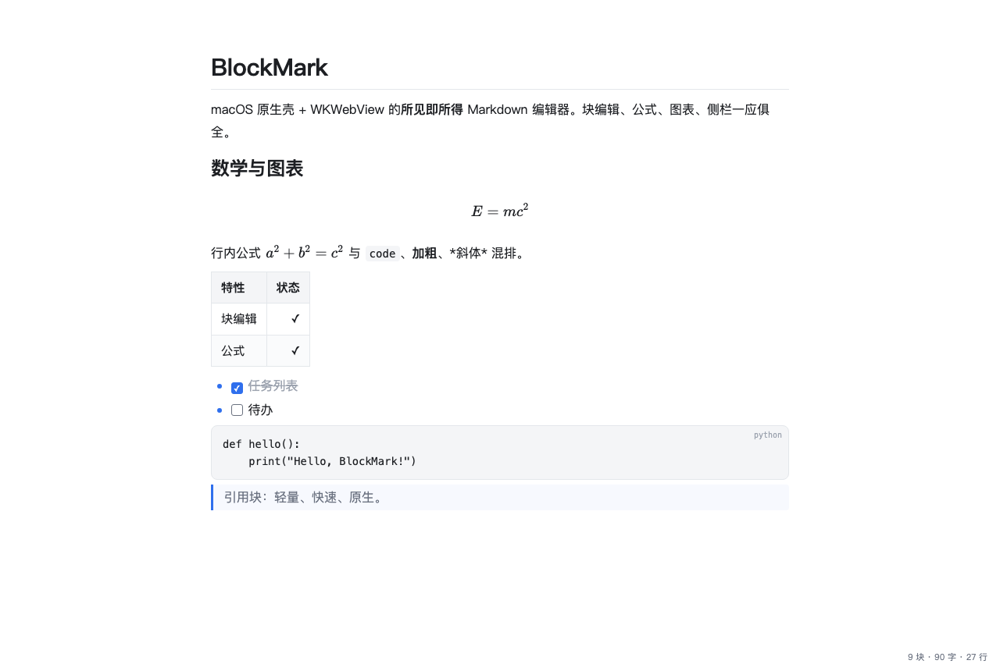

# BlockMark

所见即所得（WYSIWYG）的 macOS Markdown 编辑器：原生 Swift 薄壳 + WKWebView + 自研块模型编辑器核心。**全原创代码，零框架依赖**（不使用 Electron）。



## 特性

- **所见即所得块编辑**：点击任意块就地显示 Markdown 源码（定界符半透明常驻），离开即重渲染；⌘B/⌘I 选区包裹、Enter 延续列表/引用前缀
- **完整语法面**：标题/列表/任务（点击勾选）/引用/表格（逐单元格 Tab 导航编辑）/代码块（CodeMirror 17 语言高亮+编辑）/公式（KaTeX 块级+行内）/mermaid 图表/脚注互跳/front matter
- **侧栏**：文件树 + 大纲 + 全局搜索（⌘\ 开关）
- **查找** ⌘F（高亮+跳转）、打字机/专注模式、图片粘贴落盘 `assets/`、点击预览
- **主题**：CSS 变量化，内置 default/dark/paper，用户目录自定义主题热注入
- **文档级可靠**：1s 防抖自动保存（原子写）、外部修改三方比较（重载/冲突保留）、拖拽打开、Open Recent
- **导出**：HTML / PDF（WKWebView createPDF）/ Word docx（调用 pandoc，未装则提示）
- 体积小：原生壳 ~250KB 二进制 + 4MB 三方前端资源

## 构建

依赖：Xcode Command Line Tools（swiftc）、Node.js（构建期打包用）、[可选] Pillow（重新生成图标）

```bash
./build.sh                 # 产出 build/BlockMark.app（ad-hoc 签名）
open build/BlockMark.app
```

首次使用建议拷入 /Applications。Word 导出需另装 pandoc（`brew install pandoc`）。

## 测试

```bash
npm test          # 单测 87 项（解析器 40/行内编辑 20/语法面 27）
```

e2e 七套（m1/cm/m2b/m3/m45/look/tail）：`node tools/gen-e2e-<name>.mjs` 生成
`EditorResources/e2e-<name>.html`，headless Chromium/Edge `--dump-dom` 断言 `<title>`：

```bash
node tools/gen-e2e-tail.mjs
"/Applications/Microsoft Edge.app/Contents/MacOS/Microsoft Edge" \
  --headless --disable-gpu --allow-file-access-from-files \
  --dump-dom --virtual-time-budget=5000 \
  "file://$PWD/EditorResources/e2e-tail.html" | grep -o "<title>[^<]*</title>"
```

## 已知坑（本项目实证）

1. **WKWebView + file:// 不允许 ES module 导入**（CORS，与 headless Chrome 同症状）→ 构建期 `tools/bundle.mjs` 打平成单 classic script，app 加载 `index.bundle.html`
2. **程序化 NSWindowController 不触发 `windowDidLoad`**（nib 钩子）→ contentView 必须在 init 里挂
3. **程序化 App 的 NSDocumentController 文档类自动发现不可靠** → 自定义 `MarkdownDocumentController` 显式映射类型；裸二进制运行还要兜底创建未命名文档
4. `screencapture -l <windowid>` 抓 WKWebView 内容会是黑块（web 进程独立合成）→ 验证渲染用全屏截图或 headless e2e
5. 新 SDK（macOS 26.5 / Swift 6.3）：`saveDocument` → `save`，`readableTypes` 是 class var 属性

## 开发日志（里程碑）

MVP 已实现：paragraph / h1-h6 / 引用 / 有序无序列表 / 围栏代码 / 分隔线 / GFM 表格 / 行内（粗斜体、行内代码、链接、图片）；源码模式；导出 HTML/PDF；块级撤销。

后续路线：
- [x] M1 行内就地编辑（2026-10-10 完成）：定界符以装饰 span（`.bm-mark`）半透明常驻，`data-cs/ce` 光标激活窗口 + selectionchange 判定；IME composition 守卫；paste 强制纯文本；TreeWalker 光标偏移恢复。测试 20/20 + e2e
- [x] M2 CodeMirror 5.65（2026-10-10 完成）：代码块聚焦进入 CM 编辑（语言输入框 + blur 提交）、渲染态 runMode 高亮、源码模式 CM 替换 textarea（17 语言模式）。CM e2e PASS
- [x] M2b 语法面（2026-10-10 完成）：`$$` 公式块 + `$...$` 行内公式（KaTeX 0.16，仅 KaTeX 单渲染引擎）、mermaid 9 UMD 图表（代码块 lang=mermaid 渲染 SVG，点击走 CM 编辑）、任务列表（点击勾选翻转源码 `[ ]/[x]`）、脚注（引用↔定义互跳+闪烁定位）、front matter（文档首 `---` 块，灰底展示）。单测 27/27 + M2B-E2E PASS + 真机全要素渲染验证
- [x] M3 侧栏（2026-10-10 完成）：JS 侧栏，文件树（原生 `library.listDocs/onDocs` 桥供数，目录可展开、当前文档高亮）+ 大纲面板（标题树点击跳转）+ 全局搜索（原生 Swift 目录扫描流式回推 `globalSearch.onResults`；不捆绑外部二进制是有意选择）；⌘\\ 切换、状态持久化。M3-E2E PASS + 真机桥接验证
- [x] M4 自动保存 + 外部修改检测（2026-10-10 完成）：1s 防抖原子写入 + `changeCleared` + markSaved 回执；applicationWillTerminate 冲刷；FSEventStream 父目录监听 + 300ms 去抖；三方内容比较（disk/markdown/lastSyncedContent）区分自写回流 / 纯外部变更（自动重载+toast）/ 冲突（保留本地+toast）。真机验证：外部改文件→重载+toast、防抖写盘均 PASS
- [x] M5 主题系统（2026-10-10 完成）：全样式 CSS 变量化；内置 default/dark/paper；用户主题 `~/Library/Application Support/BlockMark/themes/*.css`（CSS 文本经桥注入 `#theme_css`，绕开 WKWebView file:// 读用户目录限制）；主题菜单勾选态 + UserDefaults 持久化
- [x] 附加（2026-10-10 完成）：图片粘贴管线（剪贴板图片→占位符→原生落盘 `<docdir>/assets/`→回推替换）、打字机模式（⌥⌘T）、专注模式（⌥⌘F，非编辑块降透明度）

- [x] P0 观感对齐轮（2026-10-11 完成）：编辑态黄底→`var(--block-hover)` 淡蓝（编辑不做"模式切换"视觉，hover 与编辑同色系）；排印节奏（内容列 820px、行高 1.8、h1 1.9em→h6 0.95em 梯度、编辑态字号不塌缩）；⌘B/⌘I 选区包裹（选区偏移数学+relight）；Enter 列表/引用前缀延续（空项消除前缀、有序自动 +1）；格式菜单（加粗⌘B/斜体⌘I/标题1-6 ⌘1-6/引用/代码块/公式块/表格⌘T/分隔线，representedObject=cmd 直发 `Editor.format`）；代码块语言角标（`pre.bm-code[data-lang]::after`）；Open Recent（NSMenuDelegate 动态菜单）；**原创应用图标**（imagegen 生成 2048px 深蓝渐变几何块，PIL superellipse n=5 遮罩→iconutil icns）。LOOK-E2E PASS（computed style 断言：h1/正文=1.9、编辑底色 rgba(47,111,237,0.04)、粗斜体真渲染、列宽 820）

- [x] 长尾功能轮（2026-10-11 完成）：**查找 ⌘F**（顶部浮条+全文 mark 高亮+Enter/Shift+Enter 跳转+计数，关闭 unwrap 恢复）；**表格逐单元格编辑**（渲染态 td/th contenteditable，点击显示该格源码，blur/Esc 写回，Tab/Shift+Tab 左右、Enter 下行同列、末行 Enter 出表格续写段落，`\|` 转义往返）；**右键菜单**（JS 收集上下文→桥→原生 NSMenu 按右键位置弹出：剪切/拷贝/粘贴（原生 pasteboard）/打开链接/拷贝链接/图片另存为/加粗/斜体）；**拖拽打开**（.md 拖入窗口→DropView→原生 odoc，NSWindow 拖拽方法不可 override 故挂 contentView）；**Pandoc 导出 Word**（-f gfm -t docx，stdin 管道；未装提示 brew install pandoc）；**URL 智能粘贴**（选中文本+粘贴 URL→[文本](URL)）；**图片点击 lightbox 预览**；**图片相对路径修复**（doc.baseDir 桥推文档目录 file URL 前缀+loadFileURL 读权限放宽到根——此前贴图 404）；任务列表删除线增强。单测 87（parser 40）+ TAIL-E2E PASS（表格导航/查找/粘贴/lightbox/图片 base/删除线）

- 单测：`node test/parser.test.mjs`（40）+ `test/m1.test.mjs`（20）+ `test/m2b.test.mjs`（27）
- e2e（全部基于 index.bundle.html 生成，Edge headless `--dump-dom` 断言 title）：`tools/gen-e2e-{m1,cm,m2b,m3,m45,look,tail}.mjs` 七套；look 套走 getComputedStyle 静态计算值断言观感（字号比/底色/列宽——dump-dom 无渲染循环，但 computed style 静态值可用，只有 transition 动画值不可靠）；link 样式表 CSSOM 在 headless 有读竞态，CSS 规则断言走构建期文件级 grep
- **坑**：file:// + ES module 直连在 headless 下加载竞态 flaky（test/e2e-harness.html 旧基建已弃用，迁 bundle 基建后稳定）；JS `String.replace` 替换串里 `$$` 是转义序列（生成器必须用函数形式 `replace(x, () => v)`）
- 真机验证：`open -a build/BlockMark.app <file>`（**裸二进制直跑 argv 不会被 AppKit 打开**——此前"argv 打开"实为 macOS 窗口恢复的假象，已实证）；截图走 `screencapture -l <winid>`

### M4 调试沉淀的 AppKit 坑

- **自定义 NSDocumentController 打开路径下，`makeWindowControllers` 可能被调用两次，且 AppKit 会绕过 `removeWindowController` 丢弃第一个控制器**——窗口还在屏幕上（`isReleasedWhenClosed=false` + AppKit 窗口列表持有），但 WKWebView 的 navigationDelegate（weak）和 WKScriptMessageHandler 里的控制器引用（weak）全部失联：页面照常渲染、JS 照常跑，但所有回调静默丢失。症状即"打开文件内容区空白"。修复：文档显式强持有控制器（`strongEditorWC`）+ `makeWindowControllers` 开头清旧保幂等
- argv 手动调 `openDocument(withContentsOf:)` 与 AppKit 原生 odoc 流程会双开同一文件（实证 documents=2）——删手动调用即可
- 验证 WKWebView 消息链路的取证手段：stderr 直写 dlog（NSLog 不进统一日志）+ ObjectIdentifier 全生命周期追踪 + removeWindowController 调用栈陷阱

## 原创声明

BlockMark 是独立开发的学习型项目。仓库中的全部代码、样式、图标均为原创或来自第三方 MIT 库，不包含任何其他商业软件的代码、美术、主题或其他资源。

## 第三方库

CodeMirror 5.65 / KaTeX 0.16 / Mermaid 9（均为 MIT），版权声明见 [THIRD_PARTY_NOTICES.md](THIRD_PARTY_NOTICES.md)。应用图标由 AI 生成。

## License

[MIT](LICENSE) © 2026 maaoBit

本项目为独立原创的学习项目，与任何其他编辑器产品及其开发方没有关联（应用图标为 AI 原创生成）。
